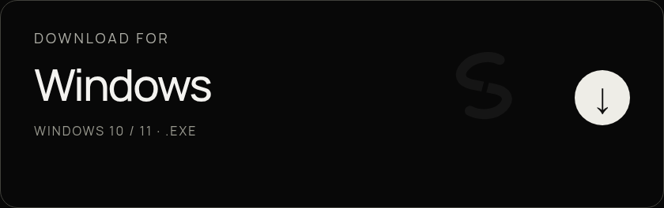
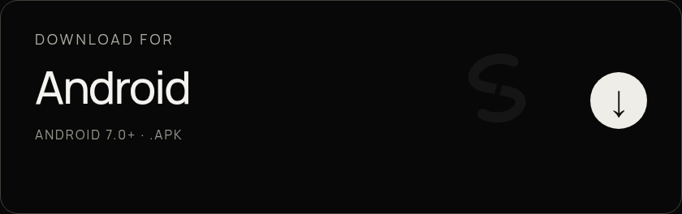
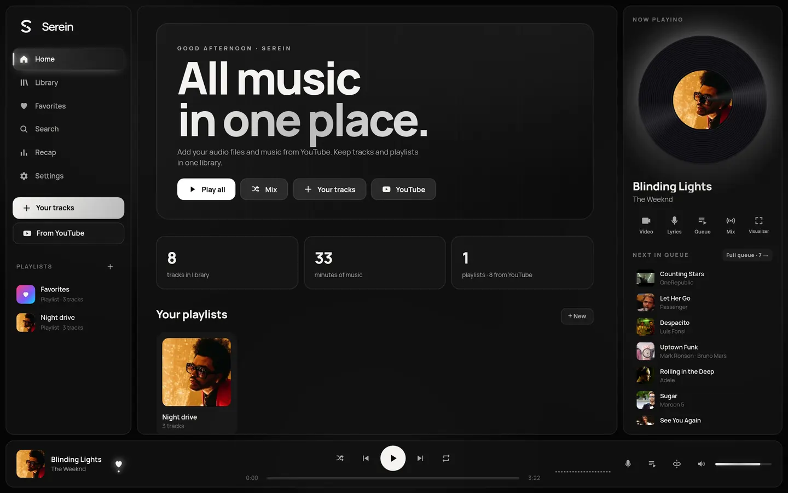
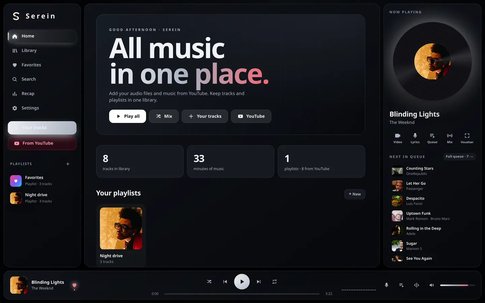
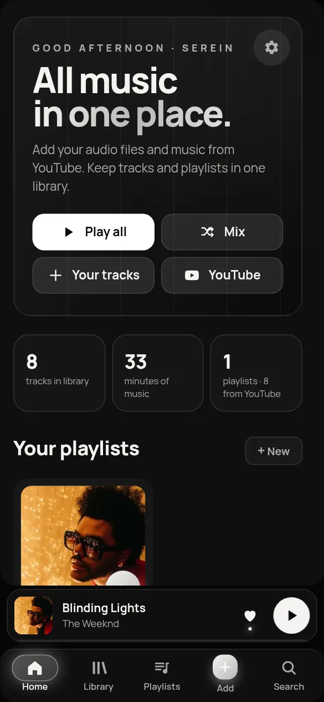

English · [Українська](README.uk.md) · [Русский](README.ru.md)

### Music wherever you want.

Your files. Your playlists. Your rhythm. One space for everything you love to hear.

**[↗ Explore the website](https://serein.pulse-apps.workers.dev/?lang=en)** · [Open web player](https://music.pulse-apps.workers.dev) · [All changes in 1.9.66](https://github.com/shadow1-ui/Serein-Music-app/releases/tag/v1.9.66)

## Download Serein 1.9.66

## Your music, together

Add local audio files, search YouTube and bring playlists into the same library. Create your own collection, start a mix, or simply press play.

## A look that feels like you

Serein brings a separate black-and-white theme without desaturating cover art. Obsidian remains the default for fresh installs. Themes, wallpapers, accents, fonts and visualizers are yours to choose.

Obsidian

## Windows + Android

Local files work offline. Online playback and imports require internet access and availability of YouTube. Sign in for library sync between devices.

## More to listen with

Lyrics · sleep timer · listening stats · mixes · Windows mini player and tray · Discord Rich Presence · English, Ukrainian and Russian interface.

## Updating from PULSE

Serein is the new name of the same player. **Install over the existing app, without uninstalling.** The library, playlists, favorites and settings use their existing storage. Back up your library before updating.

## Need a hand?

Found a problem or have an idea? Open an issue with your app version, device and steps to reproduce. This is an independent project; your feedback helps it grow.

[GitHub Issues ↗](https://github.com/shadow1-ui/Serein-Music-app/issues) · [Releases ↗](https://github.com/shadow1-ui/Serein-Music-app/releases)

---

**Serein. Music wherever you want.**
