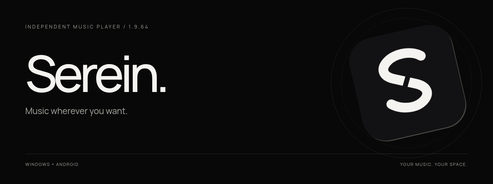
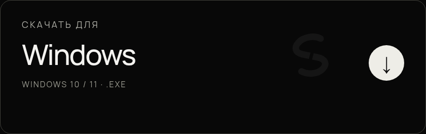
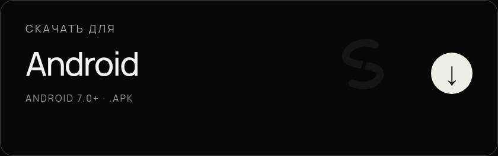
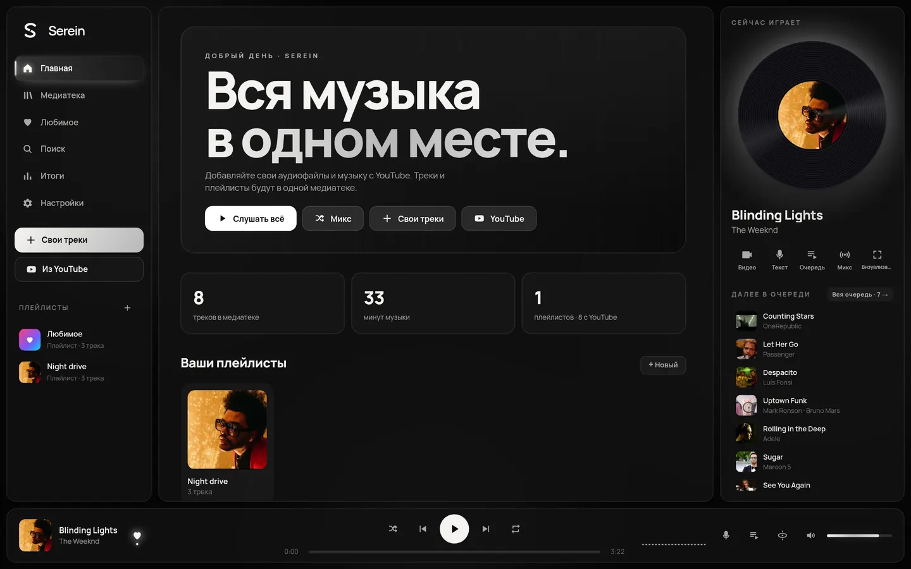
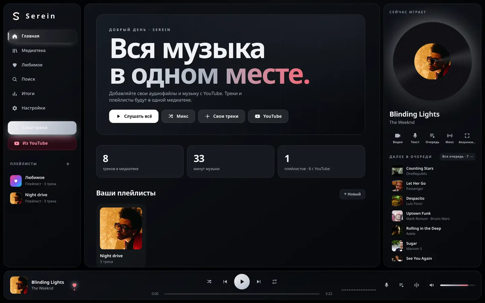
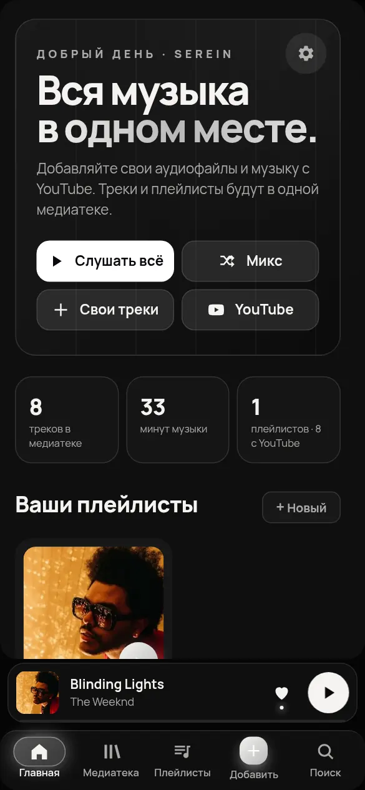

[English](README.md) · [Українська](README.uk.md) · Русский

### Музыка там, где ты захочешь.

Твои файлы. Твои плейлисты. Твой ритм. Всё, что любишь слушать, — в одном месте.

**[↗ Посмотреть сайт](https://serein.pulse-apps.workers.dev/?lang=ru)** · [Открыть веб-плеер](https://music.pulse-apps.workers.dev) · [Все изменения в 1.9.67](https://github.com/shadow1-ui/Serein-Music-app/releases/tag/v1.9.67)

## Скачать Serein 1.9.67

## Твоя музыка — рядом

Добавляй аудиофайлы с устройства, ищи музыку на YouTube и собирай всё в одной медиатеке. Создавай плейлисты, запускай миксы или просто нажимай Play.

## Выглядит так, как чувствуешь ты

Отдельная чёрно-белая тема Serein не обесцвечивает обложки. Для чистой установки по умолчанию используется Obsidian. Темы, обои, акценты, шрифты и визуализаторы — выбирай под себя.

Obsidian

## Windows + Android

Свои файлы доступны без интернета. Онлайн-воспроизведение и импорт требуют интернета и доступности YouTube. Вход в аккаунт позволяет синхронизировать медиатеку между устройствами.

## И ещё немного любимого

Тексты песен · таймер сна · итоги прослушиваний · миксы · мини-плеер и трей Windows · Discord Rich Presence · русский, украинский и английский интерфейс.

## Обновление с PULSE

Serein — новое имя того же плеера. **Устанавливай поверх, без удаления приложения.** Библиотека, плейлисты, избранное и настройки используют прежние хранилища. Перед обновлением рекомендуем резервную копию медиатеки.

## Есть идея или нашёл ошибку?

Открой Issue и укажи версию приложения, устройство и шаги для повторения проблемы. Это независимый проект; обратная связь помогает ему становиться лучше.

[GitHub Issues ↗](https://github.com/shadow1-ui/Serein-Music-app/issues) · [Releases ↗](https://github.com/shadow1-ui/Serein-Music-app/releases)

---

**Serein. Music wherever you want.**
