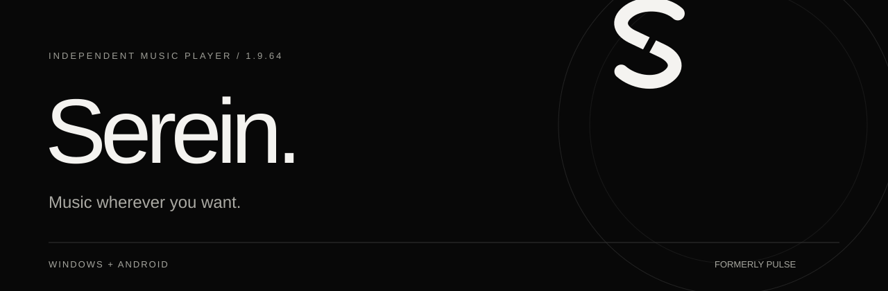
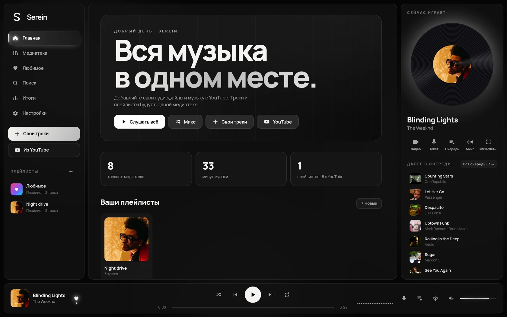
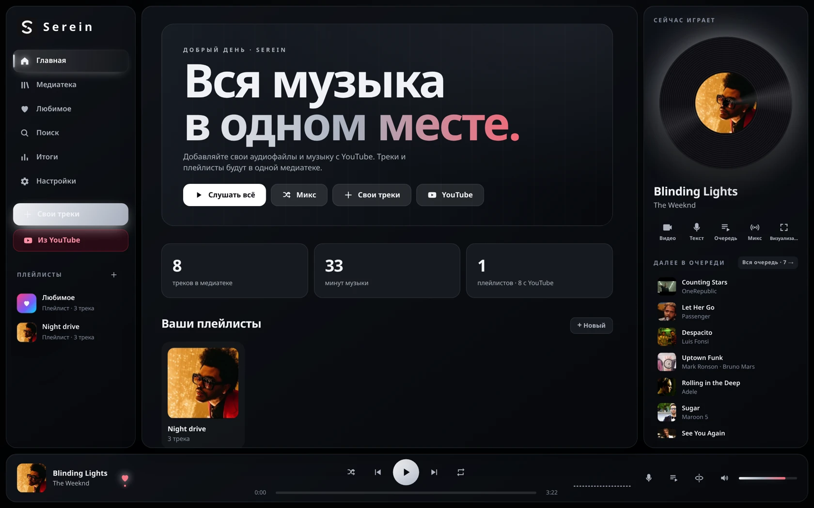
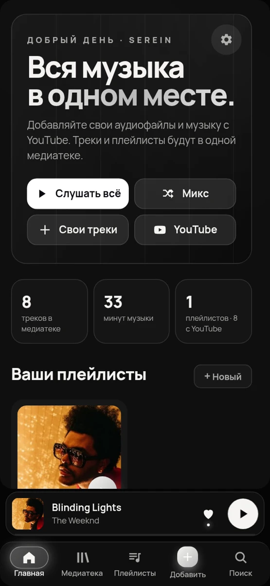

[English](README.md) · Українська · [Русский](README.ru.md)

### Музика там, де ти захочеш.

Твої файли. Твої плейлісти. Твій ритм. Усе, що любиш слухати, — в одному місці.

**[↗ Подивитися сайт](https://serein.pulse-apps.workers.dev/?lang=uk)** · [Відкрити вебплеєр](https://music.pulse-apps.workers.dev) · [Усі зміни в 1.9.64](https://github.com/shadow1-ui/PULSE-Music-app/releases/tag/v1.9.64)

## Завантажити Serein 1.9.64

| Windows | Android |
| --- | --- |
| **[↓ Serein-Setup-1.9.64.exe](https://github.com/shadow1-ui/PULSE-Music-app/releases/download/v1.9.64/Serein-Setup-1.9.64.exe)** | **[↓ Serein-Android-1.9.64.apk](https://github.com/shadow1-ui/PULSE-Music-app/releases/download/v1.9.64/Serein-Android-1.9.64.apk)** |
| Windows 10 / 11 · інсталятор .exe | Android 7.0+ · застосунок .apk |

## Твоя музика — поруч

Додавай аудіофайли з пристрою, шукай музику на YouTube та збирай усе в одній медіатеці. Створюй плейлісти, запускай мікси або просто натискай Play.

## Виглядає так, як відчуваєш ти

Окрема чорно-біла тема Serein не знебарвлює обкладинки. Для чистого встановлення типово використовується Obsidian. Теми, шпалери, акценти, шрифти й візуалізатори — обирай під себе.

Obsidian

## Windows + Android

Свої файли доступні без інтернету. Онлайн-відтворення та імпорт потребують інтернету й доступності YouTube. Вхід в обліковий запис дозволяє синхронізувати медіатеку між пристроями.

## І ще трохи улюбленого

Тексти пісень · таймер сну · підсумки прослуховувань · мікси · мініплеєр і трей Windows · Discord Rich Presence · український, англійський і російський інтерфейс.

## Оновлення з PULSE

Serein — нове ім’я того самого плеєра. **Встановлюй поверх, без видалення застосунку.** Бібліотека, плейлісти, улюблене й налаштування використовують попередні сховища. Перед оновленням радимо резервну копію медіатеки.

Android 1.9.64 має внутрішній код оновлення 83, попередні пакет і сертифікат. Це дозволяє оновитися також із приватних тестових версій 1.9.65–1.9.69.

## Маєш ідею або знайшов помилку?

Відкрий Issue та вкажи версію застосунку, пристрій і кроки для повторення проблеми. Це незалежний проєкт; зворотний зв’язок допомагає йому ставати кращим.

[GitHub Issues ↗](https://github.com/shadow1-ui/PULSE-Music-app/issues) · [Releases ↗](https://github.com/shadow1-ui/PULSE-Music-app/releases)

---

**Serein. Music wherever you want.**
